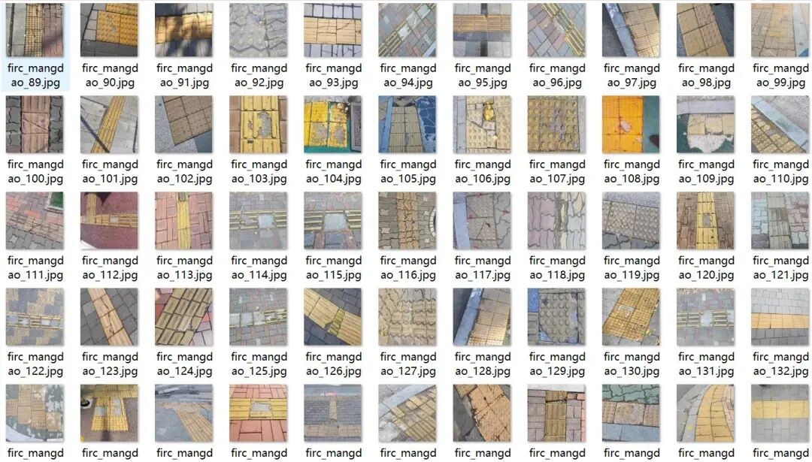
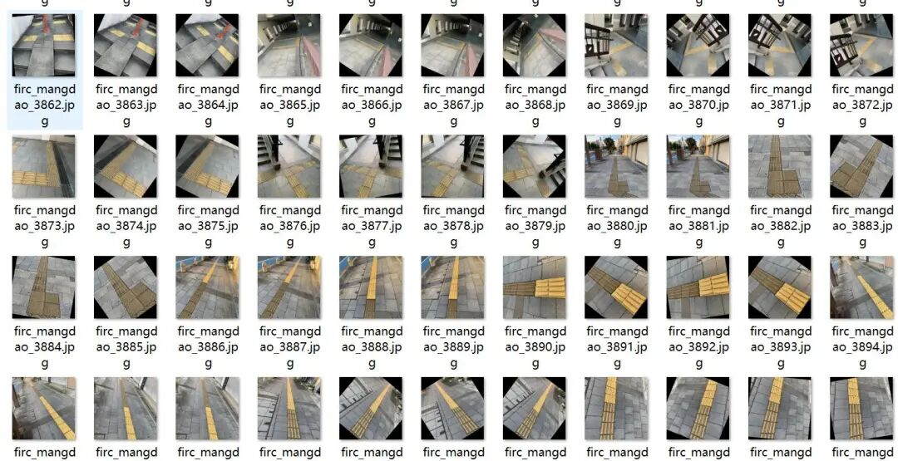
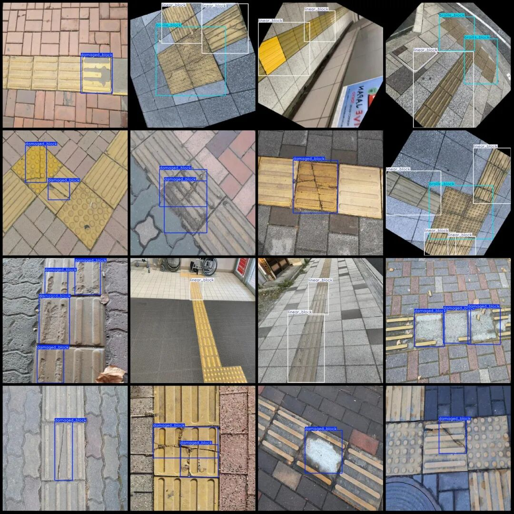

# Blind Path Damage Detection Dataset VOC+YOLO format with 4426 images in 3 categories with enhanced versions

Some rotation-enhanced images are included in the dataset. Please refer to the image preview.

Dataset format: Pascal VOC format + YOLO format (txt file without split path, only containing jpg images and corresponding VOC format xml files and yolo format txt files)

Number of images (number of jpg files): 4426

Number of annotations (number of xml files): 4426

Number of annotations (number of txt files): 4426

Label category count: 3

Label category names (Note that the order of yolo format categories does not correspond to this, but is based on the labels folder's classes.txt): ["braille_block", "damaged_block", "linear_block"]

Number of boxes labeled in each category:

braille_block Frames = 3534

damaged_block Frames = 3770

linear_block Num = 4885

Total frame count: 12189

Using labelImg:

Annotation rules: Draw a rectangle around the category.

Important Notice: No

Special : This dataset does not guarantee the accuracy or precision of the trained models or weight files. The dataset is provided with accurate and reasonable annotations only.

Image Preview:

Annotation example:

## Payment

Here is a pay link on Stripe ( https://buy.stripe.com/3cs8yP7sY87d0vu9AB ). Please contact me lonlonago@foxmail.com after funding $89, and I will send you a complete data files , thank you!

